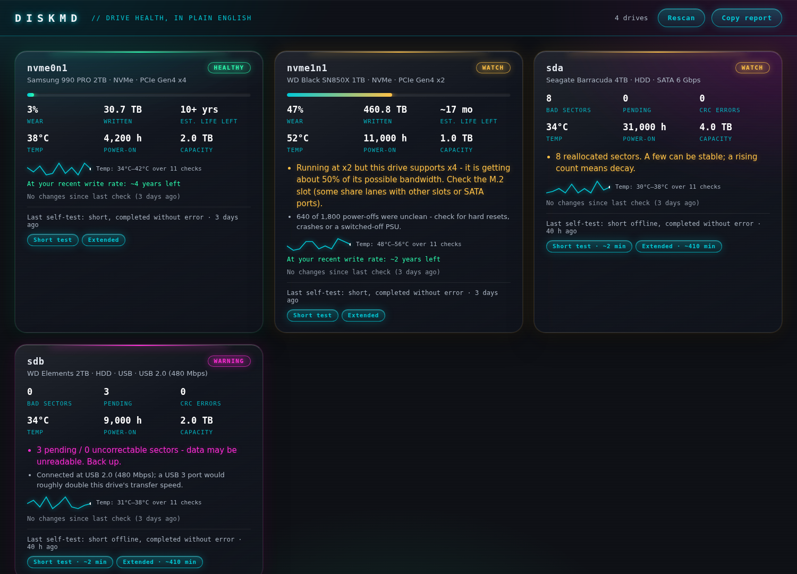
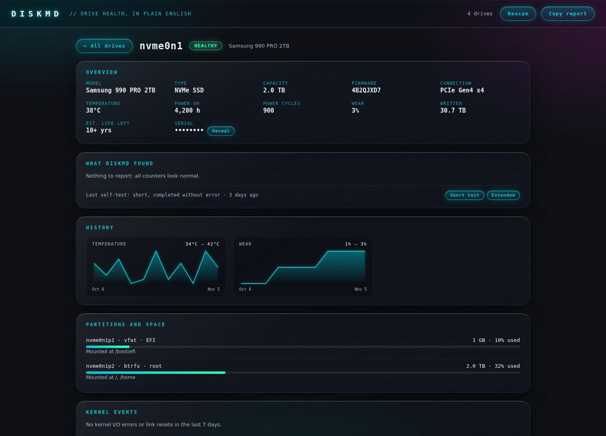

<div align="center">


<br>

<a href="https://github.com/metalmike17/diskmd/actions/workflows/test.yml"></a>
<a href="https://github.com/metalmike17/diskmd/releases/latest"></a>


<a href="https://github.com/metalmike17/diskmd/stargazers"></a>

<br><br>

**[⬇️ Download](https://github.com/metalmike17/diskmd/releases/latest)** &nbsp;·&nbsp; **[🔍 Features](#features)** &nbsp;·&nbsp; **[🚀 Install](#install)**

<br>



</div>


**Drive health for Linux, in plain English.** One command, no flags, no dependencies.

`smartctl` is powerful but hostile: raw attribute tables, a different `-d` flag for every USB
enclosure, and scary-looking numbers that mean nothing. `diskmd` does the digging for you.

<details><summary>Drive detail page with speed test</summary>



</details>

```
$ diskmd
● HEALTHY  nvme0n1  Samsung 990 PRO 2TB  2 TB NVMe
    3% worn · 30.7 TB written · 38°C · 4,200 h on · PCIe Gen4 x4 · est. 10+ years left

● WATCH    nvme1n1  WD Black SN850X 1TB  2 TB NVMe
    47% worn · 460.8 TB written · 52°C · 11,000 h on · PCIe Gen4 x2 · est. ~17 months left
    • Running at x2 but this drive supports x4 - it is getting about 50% of its possible bandwidth. Check the M.2 slot (some share lanes with other slots or SATA ports).
    ℹ 640 of 1,800 power-offs were unclean - check for hard resets, crashes or a switched-off PSU.

● WATCH    sda  Seagate Barracuda 4TB  2 TB HDD
    34°C · 31,000 h on · SATA 6 Gbps
    • 8 reallocated sectors. A few can be stable; a rising count means decay.

● WARNING  sdb  WD Elements 2TB  2 TB HDD (USB)
    34°C · 9,000 h on · USB 2.0 (480 Mbps)
    • 3 pending / 0 uncorrectable sectors - data may be unreadable. Back up.
    ℹ Connected at USB 2.0 (480 Mbps); a USB 3 port would roughly double this drive's transfer speed.

4 drive(s) checked.
```


## Features
- **Auto-detects USB bridges** - tries `sat`, `sntasmedia`, `sntjmicron`, `sntrealtek`... until one works.
- **Plain-English verdicts** - HEALTHY / WATCH / WARNING / FAILING, with the reason.
- **Context for confusing numbers** - e.g. "unsafe shutdowns" are expected on external drives.
- **Wear and life estimate** from percentage used and power-on hours.
- **Remembers last run** and tells you what changed (new unsafe shutdowns, bad sectors, wear).
- **Background alerts** - `diskmd --install-timer` checks daily and sends a desktop notification only when
  something gets worse (new bad sectors, media errors, a drive's verdict dropping). No nagging about known issues.
- **Kernel I/O error scan** - finds `I/O error`s, SATA/NVMe/USB link resets in the last 7 days and pins them on the
  right drive (via sysfs). Often an earlier warning than SMART, and tells you when it's the cable, not the drive.
- **SMART self-tests** - start a short or extended test from the GUI (or `diskmd --selftest short sda`); the card
  shows the last result and how long ago it ran. Read-only: the drive stays usable.
- **Wide SSD support** - wear and bytes-written decoded by attribute *name* (Crucial, Micron, Intel, Samsung,
  SanDisk, Kingston...), because IDs mean different things per vendor. If a drive reports nothing, it says so.
- **Link speed check** - is a fast drive being held back by how it's connected? Flags an SSD on a USB 2.0 port
  (~40 MB/s), an NVMe running at x2 instead of x4, or an SSD negotiating a slower SATA speed. No root needed.
- **Used-drive check** - `diskmd --used-check` looks for signs that SMART history was reset or altered (self-test
  logs from "the future", impossible busy time or write rates, counters that contradict each other). Signals,
  not proof - worded as things to ask a seller about.
- **Drive detail pages** - click any drive for firmware, a full SMART table with a plain-English meaning for every
  row, history charts, partitions with free space, kernel events and self-test controls.
- **Speed test** - a KDiskMark-style benchmark (the same four `fio` profiles: SEQ1M Q8T1/Q1T1, RND4K Q32T16/Q1T1)
  on any mounted drive, with a history so you can spot a drive slowing down. It writes one temporary file inside
  the drive's filesystem and deletes it - never the raw device. Needs `fio`; "Open KDiskMark" appears if installed.
- **Native window** - opens as its own app window (Qt WebEngine if PySide6 is installed, else a Chromium app window,
  else your browser). `diskmd --install-launcher` adds it to your application menu.
- **Trends** - temperature sparklines and a life estimate based on your *recent* write rate.
- **Shareable report** - `diskmd --report` prints Markdown for forum posts. Serial numbers are never included.
- NVMe, SATA SSD and HDD. `--json` for scripts. Exit code = worst verdict (0 ok, 1 watch, 2 warn, 3 fail).


## GUI
```
diskmd --gui          # opens in your browser; asks for your password via the normal system prompt
diskmd --gui --demo   # sample data, no root needed
```
Cards per drive with wear bar, temperature, life estimate, plain-English issues and what changed since
last time. The GUI is a tiny local web page (Python stdlib only): it listens on 127.0.0.1 with a random
access token, runs as you, and only the scan itself gets root (via `pkexec`).


## Install
Requires Python 3.10+ and `smartmontools`. Optional: `fio` (speed test), PySide6 (native window).

| Distro | How |
|---|---|
| Any | Download `DiskMD-*.AppImage` from [Releases](https://github.com/metalmike17/diskmd/releases), `chmod +x`, run it |
| Fedora / RHEL | `sudo dnf install ./diskmd-*.noarch.rpm` (from Releases) |
| Debian / Ubuntu | `sudo apt install ./diskmd_*_all.deb` (from Releases) |
| Arch | `PKGBUILD` in `packaging/aur/` (`makepkg -si`) |
| pipx | `pipx install git+https://github.com/metalmike17/diskmd` |

```
diskmd --gui      # the window
diskmd            # terminal report (asks for sudo itself)
```
Or run from a checkout: `python3 -m diskmd`.


## Notes
- SMART "PASSED" is a weak signal; diskmd looks at the individual counters too.
- Wear figures are the drive firmware's estimate, not a guarantee.
- diskmd only reads SMART data. It never writes to or reconfigures a drive.
- `--install-timer` is the only thing that changes your system (a systemd service + timer); `--uninstall-timer` removes it.

MIT licensed - see [LICENSE](LICENSE).
